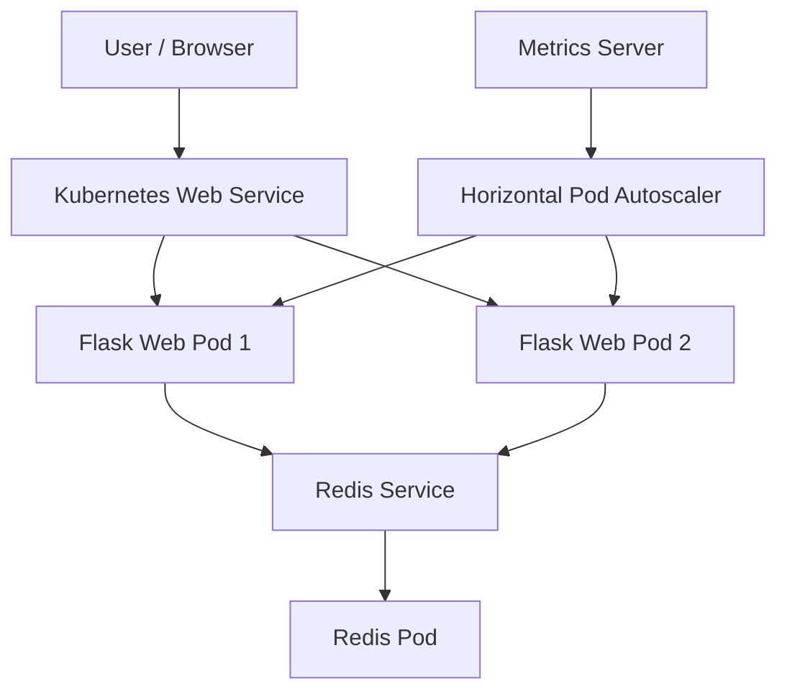
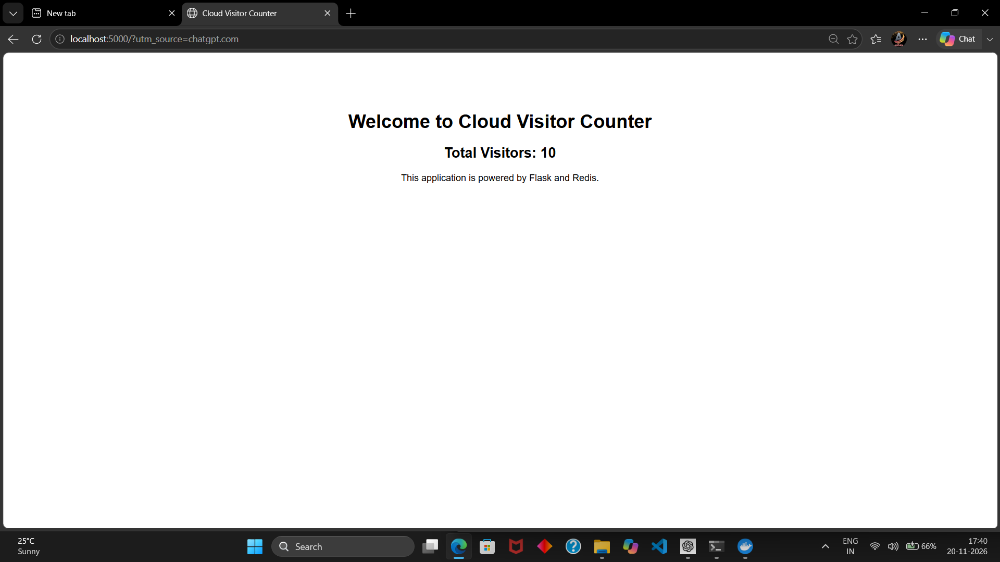
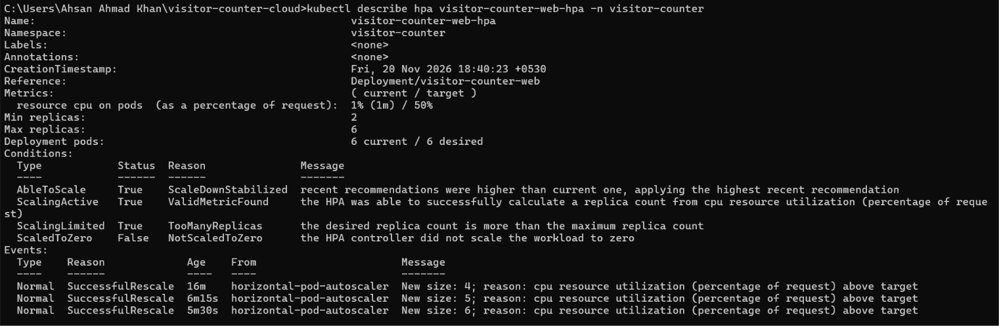
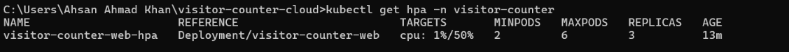
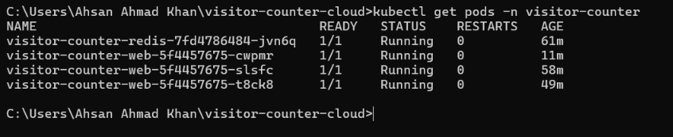
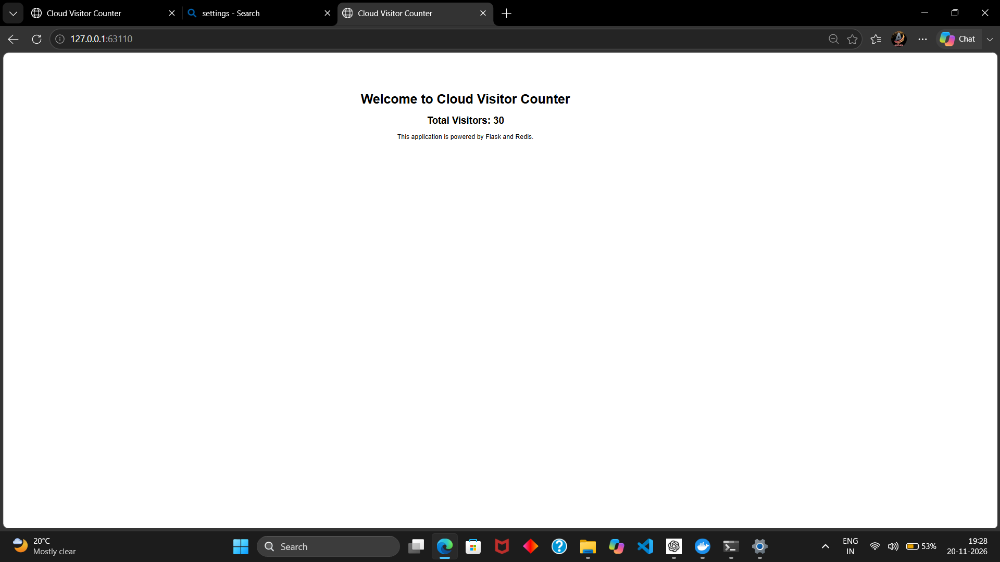
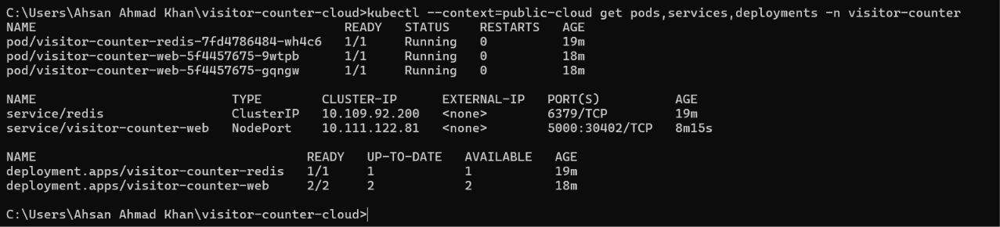

# Visitor Counter Cloud — Kubernetes & Hybrid Cloud Simulation

## Project Overview

Visitor Counter Cloud is a cloud-native web application that counts website visitors using Flask and Redis. The application is containerized using Docker and deployed on Kubernetes clusters using Minikube.

The project demonstrates containerization, orchestration, service discovery, self-healing, horizontal autoscaling, resource monitoring, and cost optimization techniques. A hybrid cloud environment is simulated using two separate local Minikube clusters representing Private Cloud and Public Cloud.

## Objectives

- Containerize a Flask application using Docker.
- Use Redis for storing visitor count data.
- Deploy the application on Kubernetes.
- Configure multiple application replicas.
- Implement self-healing using Kubernetes.
- Configure Horizontal Pod Autoscaler (HPA).
- Monitor CPU and memory utilization.
- Simulate a hybrid cloud environment.
- Explore resource and container image optimization techniques.

## Architecture



The application runs in Kubernetes with two Web replicas and a Redis backend. The Kubernetes Service provides access to the application, while the Horizontal Pod Autoscaler adjusts the number of Web replicas based on CPU utilization.

## Technologies Used

- Python
- Flask
- Redis
- Docker
- Docker Compose
- Kubernetes
- Minikube
- kubectl
- Horizontal Pod Autoscaler (HPA)
- Windows CMD

## Project Structure

```text
visitor-counter-cloud/
│
├── app/
│   ├── app.py
│   └── requirements.txt
│
├── k8s/
│   ├── redis-deployment.yaml
│   ├── web-deployment.yaml
│   ├── web-hpa.yaml
│   └── web-service.yaml
│
├── screenshots/
│
├── Dockerfile
├── docker-compose.yml
└── README.md
```

## Features

### 1. Visitor Counter Application

- Developed using Flask.
- Redis stores the visitor count.
- Visitor count increments whenever the application homepage is accessed.

### 2. Docker Containerization

- Application packaged using Docker.
- Python Slim base image used to reduce image footprint.
- Redis Alpine image used.
- Docker Compose used for local multi-container execution.

### 3. Kubernetes Deployment

- Web application deployed through Kubernetes Deployment.
- Two Web replicas configured.
- Redis deployed separately.
- Kubernetes Services used for application access and internal Redis communication.
- Resource requests and limits configured.
- Readiness probe implemented.

### 4. Self-Healing

Kubernetes automatically replaces failed Web Pods to maintain the desired replica count.

Self-healing behavior was tested by deleting a Web Pod and observing Kubernetes create a replacement Pod automatically.

### 5. Horizontal Pod Autoscaling

HPA is configured with:

| Configuration | Value |
|---|---|
| Minimum replicas | 2 |
| Maximum replicas | 6 |
| CPU target utilization | 50% |

Under load, the Web Deployment scaled from 2 Pods up to 6 Pods. After load was removed, Kubernetes automatically scaled the deployment down.

### 6. Resource Monitoring

CPU and memory usage were monitored using Kubernetes Metrics Server and the `kubectl top` command.

Resource requests and limits were configured for both Web and Redis containers.

### 7. Hybrid Cloud Simulation

The project uses two separate local Minikube clusters:

- **Private Cloud:** `minikube`
- **Public Cloud Simulation:** `public-cloud`

The same application was deployed independently on both clusters.

Both clusters contain:

- 2 Web replicas
- 1 Redis replica
- Kubernetes Deployments
- Kubernetes Services

This setup demonstrates a hybrid cloud deployment concept in a local environment. It is a simulation and does not use actual AWS, Azure, or Google Cloud infrastructure.

## Cost Optimization Techniques

### 1. Resource Utilization Monitoring

CPU and memory usage were measured using Kubernetes metrics. Resource requests and limits were configured to help manage resource allocation and avoid unnecessarily large resource reservations.

### 2. Horizontal Autoscaling

HPA dynamically increases the number of Web Pods during high CPU demand and reduces the replicas when demand decreases, helping avoid unnecessary application replicas during low traffic.

### 3. Lightweight Container Images

- Python Slim base image
- Redis Alpine image
- Pip installation using `--no-cache-dir`

These techniques help reduce container image footprint, storage requirements, and image transfer overhead.

## Screenshots & Evidence

### Application



### Kubernetes Self-Healing


### HPA Scale-Up



### HPA Scale-Down



### HPA Final State



### Hybrid Cloud — Public Cloud Simulation



### Private Cloud Final Status


### Public Cloud Simulation Final Status



### Resource Usage


### Docker Image Optimization


## Running the Project Locally

### Prerequisites

- Docker Desktop
- Python (optional for running without Docker)
- Minikube
- kubectl

### Run using Docker Compose

Clone the repository:

```bash
git clone https://github.com/YOUR-USERNAME/visitor-counter-cloud.git
cd visitor-counter-cloud
```

Start the application:

```bash
docker compose up --build
```

Open in browser:

```text
http://localhost:5000
```

Stop the application:

```bash
docker compose stop
```

## Kubernetes Deployment

Start Minikube:

```bash
minikube start
```

Create namespace:

```bash
kubectl create namespace visitor-counter
```

Deploy Redis:

```bash
kubectl apply -f k8s/redis-deployment.yaml
```

Deploy Web application:

```bash
kubectl apply -f k8s/web-deployment.yaml
```

Deploy Service:

```bash
kubectl apply -f k8s/web-service.yaml
```

Configure Autoscaling:

```bash
kubectl apply -f k8s/web-hpa.yaml
```

Check Pods:

```bash
kubectl get pods -n visitor-counter
```

Check Services:

```bash
kubectl get services -n visitor-counter
```

Check HPA:

```bash
kubectl get hpa -n visitor-counter
```

Access the application:

```bash
minikube service visitor-counter-web -n visitor-counter
```

## Monitoring Commands

View CPU and memory utilization:

```bash
kubectl top pods -n visitor-counter
```

View Deployment status:

```bash
kubectl get deployments -n visitor-counter
```

View HPA status:

```bash
kubectl get hpa -n visitor-counter
```

View cluster nodes:

```bash
kubectl get nodes
```

## Limitations

- Both cloud environments are simulated using local Minikube clusters.
- No actual cloud provider infrastructure or billing is involved.
- The project does not implement automatic cross-cluster failover.
- Redis data is not configured for cross-cluster replication.
- Public Cloud metrics-server monitoring was not fully verified.

## Future Scope

- Deploy the application on AWS, Azure, or Google Cloud.
- Implement cross-cluster traffic routing.
- Add actual hybrid cloud failover.
- Configure persistent storage for Redis.
- Integrate Prometheus and Grafana for advanced monitoring.
- Add CI/CD using GitHub Actions.
- Implement centralized logging and alerting.

## Author

**Ahsan Ahmad Khan**

B.Tech — Computer Science & Engineering

Cloud Computing Project
