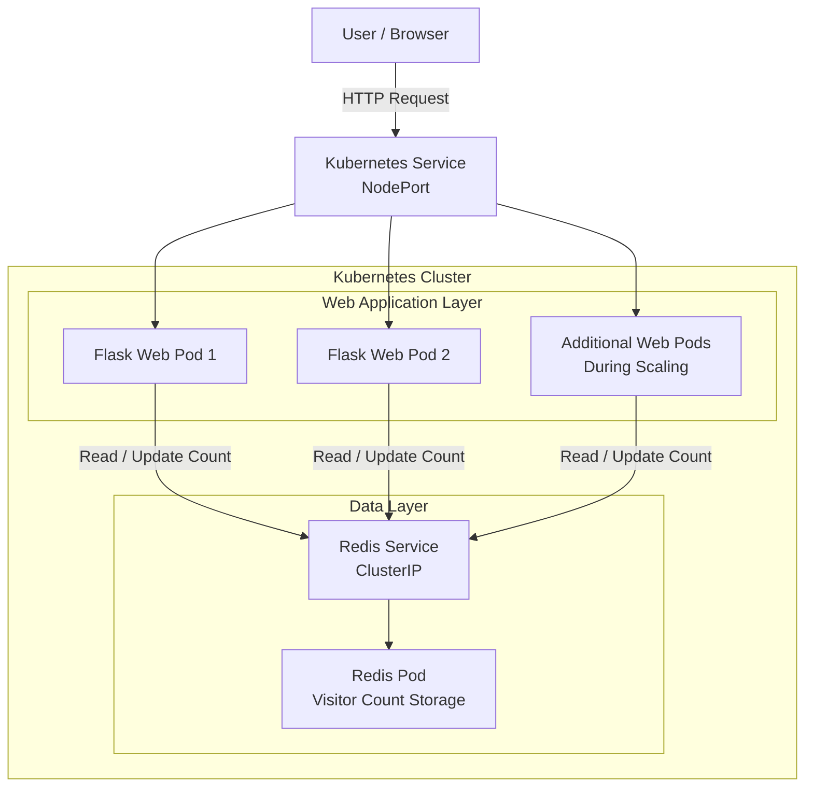
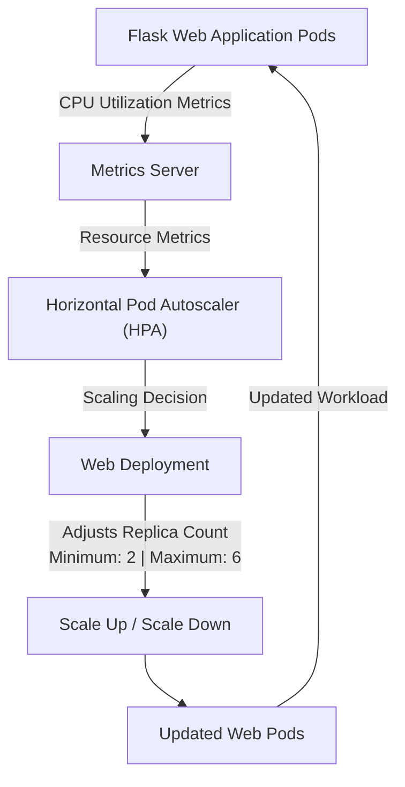
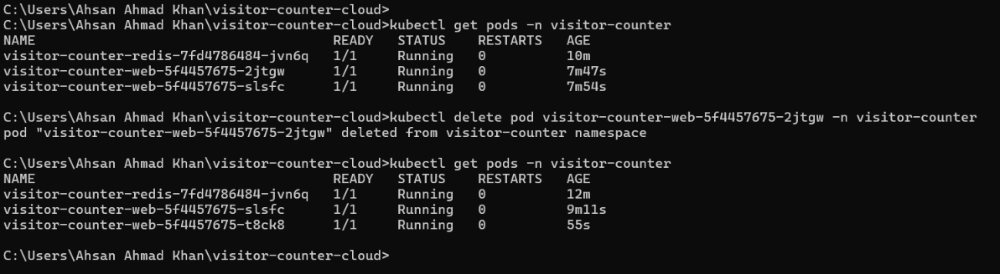
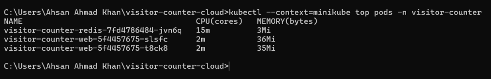
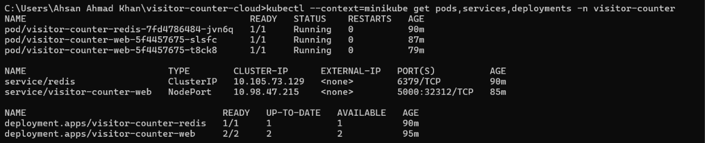
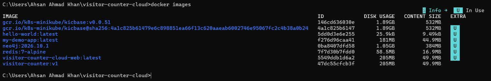
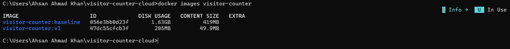

# Visitor Counter Cloud
### Kubernetes Deployment, Hybrid Cloud Simulation & Cost Optimization


## Project Details

|     Detail   |      Information      |
|--------------|-----------------------|
| Project Name | Visitor Counter Cloud |
| Student Name | Ahsan Ahmad Khan      |
| Roll Number  | 2410031083            |
| Course       | B.Tech CSE            |
| Section      | 3CSE23                |
| Subject      | Cloud Computing       |

## Project Overview

Visitor Counter Cloud is a cloud-native web application that counts website visitors using Flask and Redis.

The application is containerized using Docker and deployed on Kubernetes using Minikube. It uses multiple Web Pods, Kubernetes Services, and Horizontal Pod Autoscaling to manage application traffic and resources.

The project also simulates a hybrid cloud environment using two separate Minikube clusters representing a Private Cloud and a Public Cloud.

It focuses on Kubernetes deployment, self-healing, autoscaling, monitoring, and cost optimization.

## Objectives

- Build a web application using Flask and Redis.
- Containerize the application using Docker.
- Deploy the application on Kubernetes.
- Run multiple Web Pods for availability.
- Implement Kubernetes self-healing.
- Configure Horizontal Pod Autoscaling (HPA).
- Monitor CPU and memory usage.
- Simulate a hybrid cloud environment.
- Optimize container image size and Kubernetes resource requests.

## Architecture

### 1. Application Architecture

The following diagram shows how a user request reaches the application and how visitor data is stored.



### 2. Autoscaling Architecture

The following diagram shows how Kubernetes monitors CPU usage and adjusts the number of Web Pods.



### How It Works

1. The user opens the application in a web browser.
2. The Kubernetes NodePort Service receives the HTTP request and routes it to an available Flask Web Pod.
3. The Flask application processes the request and communicates with Redis through the Redis Service.
4. Redis stores and updates the visitor count.
5. Kubernetes manages the application Pods and automatically replaces failed Pods.
6. Metrics Server collects resource utilization metrics from the running Pods.
7. HPA monitors CPU utilization against the configured 50% target.
8. Based on resource usage, HPA instructs the Web Deployment to increase or decrease the number of replicas between 2 and 6.

## Technologies Used

| Technology | Purpose |
|---|---|
| Python | Application programming |
| Flask | Web application framework |
| Redis | Visitor counter storage |
| Docker | Containerization |
| Docker Compose | Local application deployment |
| Kubernetes | Container orchestration |
| Minikube | Local Kubernetes clusters |
| kubectl | Kubernetes management |
| HPA | Automatic scaling |
| Metrics Server | Resource monitoring |

## Project Structure

```text
visitor-counter-cloud/
│
├── app/
│   ├── app.py
│   └── requirements.txt
│
├── k8s/
│   ├── redis-deployment.yaml
│   ├── web-deployment.yaml
│   ├── web-hpa.yaml
│   └── web-service.yaml
│
├── screenshots/
│
├── Dockerfile
├── Dockerfile.baseline
├── docker-compose.yml
└── README.md
```

## Features

### 1. Visitor Counter Application

- Built using Flask.
- Redis is used to store the visitor count.
- The counter increases when the homepage is accessed.

### 2. Docker Containerization

- The Flask application is packaged into a Docker image.
- Python Slim is used as the base image to reduce image size.
- Redis uses a lightweight Alpine image.
- Docker Compose runs the application and Redis locally.

### 3. Kubernetes Deployment

- The application is deployed using Kubernetes Deployments.
- Two Web replicas are configured.
- Redis is deployed separately.
- Kubernetes Services provide application access and internal communication.
- CPU and memory requests and limits are configured.
- Readiness probes check whether the application is ready to receive requests.

### 4. Self-Healing

Kubernetes maintains the desired number of application replicas.

If a Web Pod fails or is deleted, Kubernetes automatically creates a replacement Pod.

This behavior was tested by deleting a Web Pod and observing its automatic replacement.



### 5. Horizontal Pod Autoscaling

Horizontal Pod Autoscaler adjusts the number of Web Pods based on CPU utilization.

| Configuration | Value |
|---|---:|
| Minimum replicas | 2 |
| Maximum replicas | 6 |
| CPU target utilization | 50% |

During load testing, the application scaled from 2 Web Pods to 6 Web Pods. After the load was removed, it scaled down to 2 Web Pods.

#### Scale-Up


#### Scale-Down


#### Final HPA Status


### 6. Resource Monitoring

CPU and memory usage were monitored using Kubernetes Metrics Server and the `kubectl top` command.

Resource requests and limits were configured for the Web and Redis containers.



### 7. Hybrid Cloud Simulation

The project uses two independent Minikube clusters to represent two cloud environments.

| Environment | Minikube Profile |
|---|---|
| Private Cloud | `minikube` |
| Public Cloud Simulation | `public-cloud` |

The application was deployed separately on both clusters.

Each cluster contains:

- 2 Web Pods
- 1 Redis Pod
- Kubernetes Deployments
- Kubernetes Services

The Private Cloud and Public Cloud simulation can run independently. The application was tested on the public-cloud cluster while the private-cloud environment was stopped.

This demonstrates the basic idea of hybrid cloud availability using a local simulation.

**Note:** Both environments run locally using Minikube. No actual AWS, Azure, or Google Cloud infrastructure is used.


#### Private Cloud Status



#### Public Cloud Simulation Status


## Cost Optimization

Three optimization techniques were implemented and measured.

### 1. Docker Image Optimization

The baseline Docker image used the full `python:3.12` image. It was optimized by switching to `python:3.12-slim` and using pip with `--no-cache-dir`.

| Image | Size |
|---|---:|
| Baseline (`python:3.12`) | 419 MB |
| Optimized (`python:3.12-slim`) | 49.9 MB |
| Size Reduction | 88.1% |

The optimized image uses less storage and reduces image transfer overhead.



#### Image Size Comparison



### 2. Horizontal Pod Autoscaling

HPA was configured to maintain between 2 and 6 Web Pods with a CPU target of 50%.

- Under higher load, the number of Web Pods increased from 2 to 6.
- After load decreased, the number of Web Pods returned from 6 to 2.

This helps avoid running unnecessary application replicas when demand is low.

### 3. Resource Right-Sizing

CPU and memory requests were reduced based on observed resource usage.

| Resource | Before | After | Reduction |
|---|---:|---:|---:|
| CPU Request per Web Pod | 100m | 50m | 50% |
| Memory Request per Web Pod | 128Mi | 64Mi | 50% |
| CPU Limit per Web Pod | 500m | 500m | Unchanged |
| Memory Limit per Web Pod | 256Mi | 256Mi | Unchanged |

After optimization, the observed Web Pod usage was approximately 2m CPU and 29Mi memory.

The HPA was also observed with 2 replicas and a reported CPU utilization of 4%.

These changes reduce the requested resources per Web Pod and improve resource utilization.

Actual cloud billing savings were not measured because the project runs in a local Minikube environment.

## Cost Analysis: Before-and-After Comparison

The following table compares the project configuration before and after optimization.

| Parameter | Before Optimization | After Optimization | Improvement |
|---|---:|---:|---:|
| Docker Image Size | 419 MB | 49.9 MB | 88.1% reduction |
| CPU Request per Web Pod | 100m | 50m | 50% reduction |
| Memory Request per Web Pod | 128Mi | 64Mi | 50% reduction |
| CPU Limit per Web Pod | 500m | 500m | No change |
| Memory Limit per Web Pod | 256Mi | 256Mi | No change |
| Minimum Web Replicas | 2 | 2 | No change |
| Maximum Web Replicas | Not configured | 6 | Autoscaling enabled |
| CPU Utilization Target | Not configured | 50% | HPA configured |

### Cost Analysis Explanation

1. **Docker Image Optimization:** The image size was reduced from 419 MB to 49.9 MB, decreasing storage requirements and image transfer overhead.
2. **Resource Right-Sizing:** CPU and memory requests per Web Pod were reduced by 50%, allowing more efficient resource allocation.
3. **Horizontal Pod Autoscaling:** HPA automatically scales Web Pods between 2 and 6 according to CPU utilization, helping avoid unnecessary application replicas during low traffic.

**Cost Analysis Limitation:** Actual cloud billing savings were not measured because the project runs on local Minikube clusters. The improvements represent resource and infrastructure efficiency, not verified monetary savings.

## Project Results

The project successfully demonstrates:

- Docker containerization of a Flask application.
- Kubernetes deployment using Web and Redis components.
- Multiple Web replicas.
- Kubernetes self-healing through Pod replacement.
- HPA scale-up from 2 to 6 Web Pods.
- HPA scale-down from 6 to 2 Web Pods.
- CPU and memory monitoring.
- Docker image size reduction of 88.1%.
- CPU request reduction of 50%.
- Memory request reduction of 50%.
- Hybrid cloud simulation using two independent Minikube clusters.

## Screenshots & Evidence

All project screenshots are available in the `screenshots/` directory.

| Screenshot | Demonstration |
|---|---|
| `visitor-counter-local.png` | Local application |
| `self-healing.png` | Pod replacement |
| `hpa-scale-up.png` | Scaling from 2 to 6 |
| `hpa-scale-down.png` | Scaling down after load |
| `hpa-final-state.png` | Final HPA state |
| `hybrid-public-cloud.png` | Public cloud simulation |
| `private-cloud-final-status.png` | Private cluster status |
| `public-cloud-final-status.png` | Public cluster status |
| `resource-usage-baseline.png` | Resource monitoring |
| `docker-image-optimization.png` | Docker image optimization |
| `docker-image-optimization-comparison.png` | Image size comparison |

## Running the Project Locally

### Prerequisites

Install the following tools:

- Docker Desktop
- Python (optional for running without Docker)
- Minikube
- kubectl

### 1. Clone the Repository

```bash
git clone https://github.com/Ahsan-Ahmad-Khan/visitor-counter-cloud.git
cd visitor-counter-cloud
```

### 2. Run Using Docker Compose

Build and start the application:

```bash
docker compose up --build
```

### 3. Open the Application

Open the following URL in your browser:

```text
http://localhost:5000
```

### 4. Stop the Application

```bash
docker compose stop
```

## Kubernetes Deployment

The following commands deploy the application on a Minikube cluster.

### 1. Start Minikube

```bash
minikube start
```

### 2. Create Namespace

```bash
kubectl create namespace visitor-counter
```

### 3. Deploy Redis

```bash
kubectl apply -f k8s/redis-deployment.yaml
```

### 4. Deploy Web Application

```bash
kubectl apply -f k8s/web-deployment.yaml
```

### 5. Deploy Web Service

```bash
kubectl apply -f k8s/web-service.yaml
```

### 6. Configure Autoscaling

```bash
kubectl apply -f k8s/web-hpa.yaml
```

### 7. Check Pods

```bash
kubectl get pods -n visitor-counter
```

### 8. Check Services

```bash
kubectl get services -n visitor-counter
```

### 9. Check HPA

```bash
kubectl get hpa -n visitor-counter
```

### 10. Access the Application

```bash
minikube service visitor-counter-web -n visitor-counter
```

## Monitoring Commands

### View CPU and Memory Usage

```bash
kubectl top pods -n visitor-counter
```

### View Deployments

```bash
kubectl get deployments -n visitor-counter
```

### View HPA Status

```bash
kubectl get hpa -n visitor-counter
```

### View Cluster Nodes

```bash
kubectl get nodes
```

## Limitations

- Both cloud environments are simulated using local Minikube clusters.
- No actual AWS, Azure, or Google Cloud infrastructure is used.
- No actual cloud billing data is available.
- Automatic cross-cluster failover is not implemented.
- Redis data is not replicated between the two clusters.
- Public Cloud metrics-server monitoring was not fully verified.

## Future Scope

- Deploy the application on AWS, Azure, or Google Cloud.
- Implement automatic cross-cluster failover.
- Configure Redis replication between cloud environments.
- Add persistent storage for Redis.
- Integrate Prometheus and Grafana for advanced monitoring.
- Implement CI/CD using GitHub Actions.
- Add centralized logging and alerting.
- Configure cloud load balancing and traffic routing.

## Author

**Ahsan Ahmad Khan**

B.Tech — Computer Science & Engineering

Cloud Computing Project
